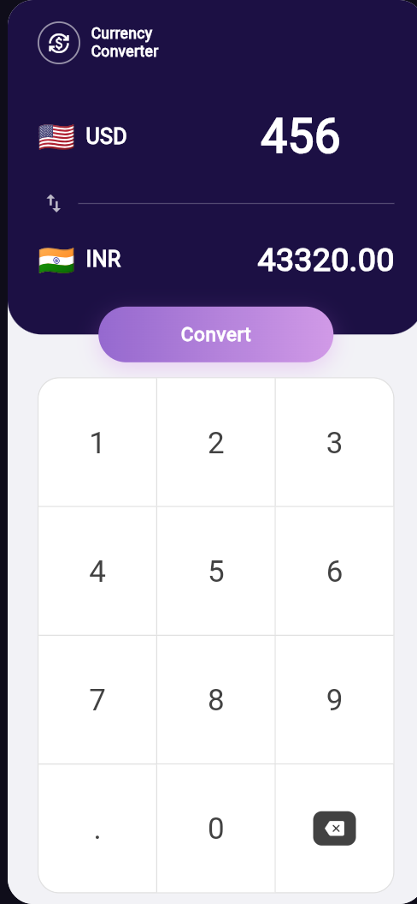

# Currency Converter

A minimal, single-screen **USD ⇄ INR** currency converter built with Flutter. Custom numeric keypad, instant conversion, and a clean dark-purple Material 3 UI.



## Features

- **USD ⇄ INR conversion** with a one-tap **swap** to flip the direction
- **Custom in-app keypad** — no system keyboard, everything stays on one screen
- **Instant convert** with 2-decimal formatted output
- **Material 3** theme, edge-to-edge layout that respects system insets

> **Note:** this demo build uses a fixed rate (₹95 / $1). Plugging in a live exchange-rate API is a natural next step.

## Download

Grab the latest APK from the [Releases page](https://github.com/aditya18saxena-afk/currency_converter/releases/latest):

**[⬇ app-release.apk](https://github.com/aditya18saxena-afk/currency_converter/releases/latest/download/app-release.apk)**

## Tech

- **Flutter / Dart** — single `StatefulWidget` screen, no external packages
- Android + web targets

## Project structure

```
lib/
├── main.dart                              # App entry, Material 3 theme
└── currency_converter_material_page.dart  # Converter screen: keypad, swap, convert
```

## Run it

```bash
flutter pub get
flutter run
```

Build a release APK:

```bash
flutter build apk --release
# output: build/app/outputs/flutter-apk/app-release.apk
```

## Author

**Aditya Saxena** — [GitHub](https://github.com/aditya18saxena-afk) · [LinkedIn](https://www.linkedin.com/in/aditya-saxena-645aa0380/)
